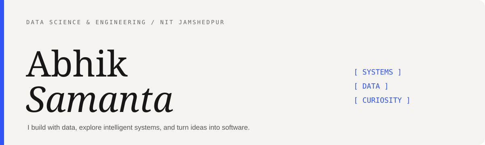
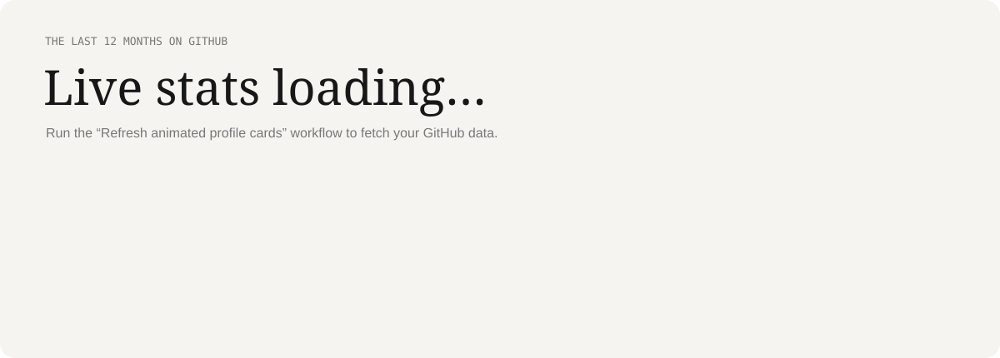
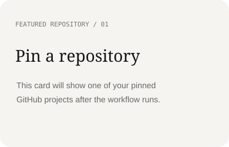

<!-- ABHIK SAMANTA | Animated profile. SVG assets are generated by render_readme_cards.py. -->

  
  

---

## A little about me

I'm **Abhik Samanta**, an M.Tech student in **Data Science and Engineering at NIT Jamshedpur**. I completed my B.Tech in Computer Science and Engineering from **KIIT University with a CGPA of 9.44**.

I enjoy working at the intersection of software engineering, data, and intelligent systems — turning ideas into useful products while continuously strengthening my fundamentals.

- **Currently exploring:** AI, Machine Learning, Data Science and full-stack engineering
- **I work with:** Python, C++, Java, JavaScript, TypeScript and modern web technologies
- **I enjoy:** building projects, solving DSA problems and learning how systems work end to end

---

## Tools I use !

<table>
<tr>
<td width="50%" valign="top">

**Languages**

**AI · Machine Learning · Data Science**

`NumPy` · `Pandas` · `Scikit-learn` · `Matplotlib` · `Jupyter`

</td>
<td width="50%" valign="top">

**Web development**

**Databases & tools**

</td>
</tr>
</table>

---

## GitHub, in motion

---

## Selected work

  
  
  

<a href="https://github.com/Abhik004?tab=repositories">Explore all repositories ↗</a>

---

## Find me around the web

  
  
  

<i>Curiosity in mind. Code in progress. One commit at a time.</i>

